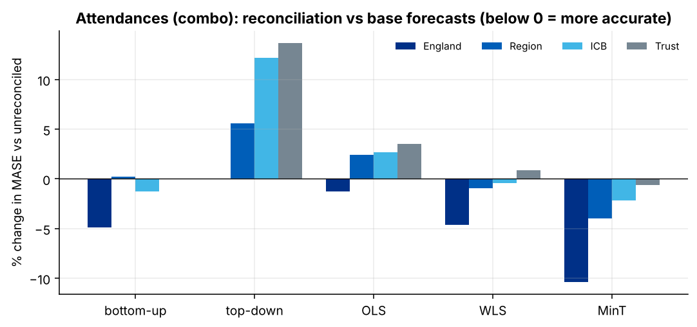
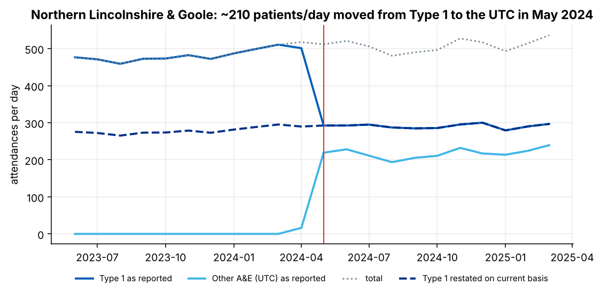
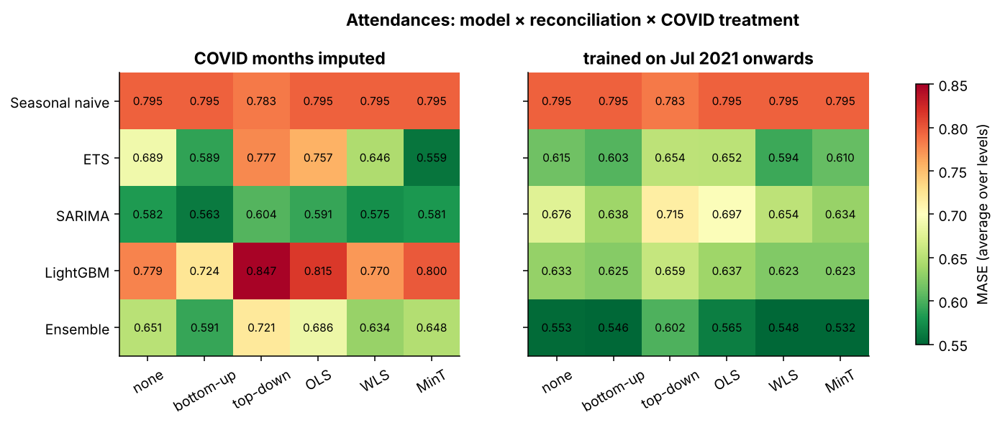
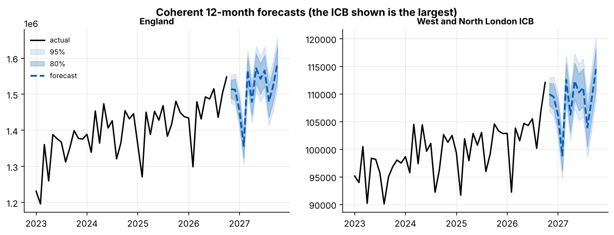
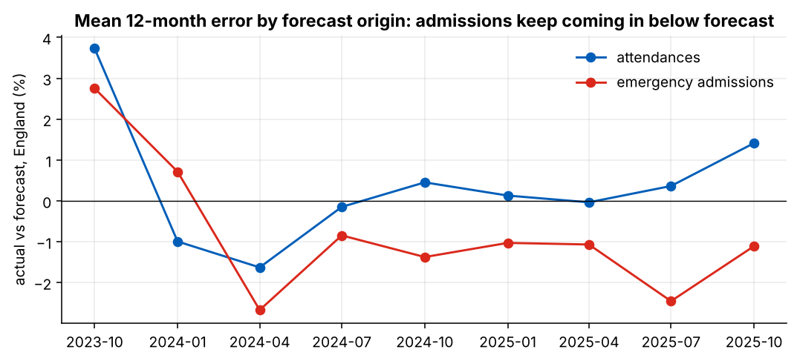
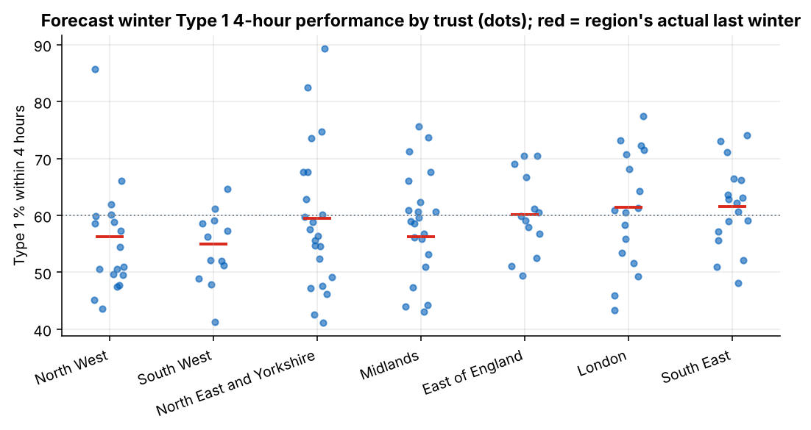

# NHS A&E Demand Forecast: Coherent Forecasts from Trust to England, and 4-Hour Risk

[](https://github.com/TilakHeble/nhs-ae-demand-forecast/actions/workflows/ci.yml)
[](https://nhs-ae-demand-forecast.streamlit.app/)

**How much A&E demand should each of England's 120 acute trusts, 36 ICBs and 7 regions plan for over the next year, with every level's forecast adding up? How confident should planners be? And which trusts are most at risk on 4-hour waits this winter?**

Time series forecasting end to end, on **every NHS England monthly A&E return from April 2018 to October 2026**. Classical models (ETS, SARIMA), a global LightGBM and an ensemble are forecast across a 164-series hierarchy and **reconciled** so trusts add up to ICBs, ICBs to regions and regions to England (bottom-up, top-down, OLS, WLS, **MinT**). Every choice is made in a 9-origin rolling backtest.

> Project 6a in my one-project-per-model portfolio. **Model family: time series and hierarchical forecast reconciliation.**

- 📊 **[Live dashboard](https://nhs-ae-demand-forecast.streamlit.app/)**: drill from England to any trust, winter outlook, 4-hour risk with your own threshold, full model comparison
- 📄 **[Executive summary](docs/executive_summary.md)** · [Model development document](docs/model_development_document.md) · [Validation report](docs/validation_report.md)
- 📓 **[notebooks/](notebooks/)**: six run notebooks, from the raw data to the 4-hour risk model
- 🎓 **[learn/](learn/README.md)**: an 8-lesson time series course on this project's data, plus interview questions, a cheat sheet and a glossary

## Headline results

| | Finding |
|---|---|
| 🎯 **Accuracy** | Ensemble + MinT. Type 1 attendance MAPE **1.7%** England, **3.2%** ICB, **4.2%** trust, 12 months ahead. MASE 0.40–0.66 against 0.71–0.89 for "same month last year" |
| 🔗 **Reconciliation** | MinT is the most accurate method at **every** level, and 10% more accurate at England level than not reconciling. Top-down splitting is the worst (12–14% worse at ICB and trust level) |
| 🔎 **A data problem nobody mentions** | **32 recording changes at 25 trusts.** When a trust opens a co-located urgent treatment centre, thousands of patients a month move from "Type 1" to "Other" in the returns. A data contract caught it. Restating them cut ICB-level error from 3.9% to 3.2% |
| 📉 **A real shift** | Emergency admissions via A&E have come in **1–3% below forecast at every origin since April 2024**. Admissions per 100 attendances fell from 30 to about 27. Flagged for operational teams, not tuned away |
| ⏱️ **4-hour risk** | Quantile LightGBM. Median error **3.9 pp** vs 4.3 for the best simple rule. Brier skill **54%**. Calibrated 80% ranges cover 82%. This winter **69 of 120** trusts are more likely than not below 60% Type 1 performance |
| 📈 **Forecast** | England Type 1 attendances **+3.7%** over Nov 2026 – Oct 2027 (about 18.2 million) |



## The problem

NHS capacity planning happens at several levels at once: trusts plan beds and rotas, ICBs plan system flow, and regions and NHS England plan winter funding. When each level forecasts on its own, the trust forecasts don't add up to the ICB's. Here the unreconciled trust forecasts summed to anything from 2.3% below to 2.4% above the England forecast, a gap of up to 35,000 attendances a month. **Reconciliation** makes the 164 forecasts coherent, and the backtest shows it makes them *more* accurate too.

```
England (1) → Regions (7) → ICBs (36) → Acute trusts with a Type 1 A&E (120)
```

## Data, and restating eight years of history onto today's NHS

**Source:** NHS England, *A&E Attendances and Emergency Admissions* (Accredited Official Statistics, OGL v3.0). 103 monthly CSVs and the October 2026 provider-to-ICB mapping.

| Problem | Fix | Check |
|---|---|---|
| Column names change across eight years of files | one schema for every header variant (`nhsae.ingest`) | data contract: every month, no duplicates, no negatives |
| **21 trust mergers**: old codes stop, successors appear to double | history mapped to the successor (`nhsae.panel`) | combined series continuous across each merger |
| **32 Type 1 ↔ UTC recording changes** at 25 trusts | earlier history rescaled to the trust's current recording basis (`nhsae.reclass`) | restated series continuous; synthetic unit tests |
| COVID (Apr 2020 – Jun 2021) | impute a counterfactual *or* train on Jul 2021 onwards. The backtest chooses | – |
| February has 28 days | every model forecasts the **daily rate** | – |



The recording-change problem was found by a data contract written to catch *unmapped mergers*: no trust's Type 1 daily rate may move more than 60% in a month. It failed for two trusts that hadn't merged. They had opened, or folded back, an urgent treatment centre. A systematic search then found 32 events. Without restatement a model sees Northern Lincolnshire's demand "collapse" by 42% overnight.

## Methods

| Base model | |
|---|---|
| Seasonal naive | same month last year: the benchmark |
| ETS | damped Holt-Winters on the log daily rate |
| SARIMA | airline model (0,1,1)(0,1,1)₁₂ on the log daily rate |
| Global LightGBM | **one model across all 164 series**, direct multi-horizon, scale-free features |
| Ensemble | equal-weight ETS + SARIMA + LightGBM |

**Reconciliation**, ỹ = S G ŷ: bottom-up, top-down, OLS, WLS (structural) and **MinT-shrink** (Wickramasuriya, Athanasopoulos & Hyndman, 2019), all implemented from scratch in [`src/nhsae/hierarchy.py`](src/nhsae/hierarchy.py).

**Evaluation:**
- Rolling origin: 9 origins (October 2023 to October 2025), 12 months ahead.
- MASE, MAPE, CRPS and interval coverage.
- 5 models × 6 reconciliations × 2 COVID treatments × 2 measures × 164 series × 9 origins × 12 horizons, about **2.1 million scored forecasts**.



## Results

### Type 1 A&E attendances: ensemble · MinT · trained post-COVID

| Level | MASE | MAPE | CRPS (scaled) | 80% PI coverage | 95% PI coverage | Seasonal-naive MASE |
|---|---|---|---|---|---|---|
| England | **0.396** | 1.7% | 0.307 | 88% | 95% | 0.707 |
| Region | **0.459** | 2.1% | 0.335 | 87% | 96% | 0.719 |
| ICB | **0.613** | 3.2% | 0.446 | 77% | 91% | 0.868 |
| Trust | **0.662** | 4.2% | 0.489 | 80% | 92% | 0.886 |

### Emergency admissions via Type 1 A&E: ensemble · MinT · COVID imputed

| Level | MASE | MAPE | 80% PI coverage (after calibration) | Seasonal-naive MASE |
|---|---|---|---|---|
| England | **0.377** | 2.0% | 89% | 0.512 |
| Region | **0.522** | 2.8% | 79% | 0.681 |
| ICB | **0.752** | 5.8% | 75% | 0.962 |
| Trust | **0.882** | 8.5% | 80% | 1.096 |



### What I learned

- **The ensemble wins for both measures.** On its own, the global LightGBM was mid-table. Its value is as a *diverse* ensemble member.
- **There is no universal COVID fix.** Dropping the COVID years was best for attendances, imputing them for emergency admissions, and imputing helped a single SARIMA most (0.563 vs 0.634), because seasonal differencing carries a shock forward a year. So the backtest searches COVID treatment alongside the model.
- **Data contracts pay for themselves.** One check written for mergers found a bigger problem, and fixing it improved attendance accuracy (average MASE 0.568 → 0.532, ICB MAPE 3.9% → 3.2%).
- **Intervals need testing, and calibration choices need testing too.** The first intervals covered 96–100% when they promised 80%. Later, emergency-admission intervals covered only 66–73% at ICB and trust level. Four calibration options were compared **online**, each calibrated only on errors already observed at each origin. A single pooled conformal multiplier won (75–80% coverage). Finer-grained options lost, because England is one series.
- **Calibration can't fix bias.** The emergency-admissions over-forecast is a shift in the world, not noise.



## 4-hour performance risk

Demand forecasts matter because of what they do to waits. [`src/nhsae/four_hour.py`](src/nhsae/four_hour.py) forecasts each trust's **Type 1 4-hour performance** at 7 quantiles with a global LightGBM. The features are the trust's recent performance, national pressure, the admission rate and **demand pressure**: in the backtest, this is the reconciled demand forecast actually available at each origin. Quantiles are conformalised online and turned into P(performance < any threshold).

| Backtest (7 origins, 10,080 trust-months) | |
|---|---|
| Median forecast error | **3.86 pp** vs 4.27 (last 3 months), 4.36 (last month), 4.99 (same month last year) |
| Brier skill, P(below 60%) | **54%** better than always predicting the base rate |
| Brier skill, P(worse than same month last year) | **23%** |
| 80% / 90% range coverage | 74% / 85% raw → **82% / 91%** after conformal calibration |

Recent flow dominates (last month and last 3 months make up 62% of the gain). Demand pressure adds about 3%. That fits notebook 02: per day, A&E demand isn't highest in winter, so winter pressure builds behind the front door.



The national 4-hour objective (82% in 2026/27) covers all A&E types, including urgent treatment centres. This model covers **Type 1** departments, where performance is lowest (about 60% nationally).

## Dashboard

```bash
streamlit run app/streamlit_app.py
```

- **Forecast:** England, any region, ICB or trust, with 80% and 95% intervals
- **Winter outlook:** trusts ranked by forecast December–February change
- **4-hour risk:** pick a threshold; probabilities, fan chart, backtest evidence and calibration
- **Model comparison:** every model × reconciliation × level (MASE, CRPS, MAPE, coverage), plus accuracy by horizon
- **How reconciliation works:** a plain-English explainer

## Run it yourself

```bash
pip install -e ".[dev,dashboard]"
make data        # raw NHS files -> restated trust-month panel (data contracts run here)
make backtest    # ~25 min on 2 cores
make forecast    # refit the winning configuration
make calibrate   # choose interval calibration online, refresh forecasts
make four_hour   # 4-hour risk model
make notebooks   # execute notebooks/src/*.py -> notebooks/*.ipynb + docs/figures
make test        # 46 tests: ingest, contracts, reclassification, reconciliation maths, models, outputs, dashboard, course
```

## Repository structure

```
src/nhsae/
  ingest.py      read and harmonise eight years of changing file formats
  contracts.py   data contracts (run on every build and in CI)
  panel.py       merger restatement, hierarchy build
  reclass.py     detect and restate Type 1 ↔ UTC recording changes
  hierarchy.py   summing matrix S; BU / TD / OLS / WLS / MinT; shrinkage covariance
  models.py      COVID treatments, seasonal naive, ETS, SARIMA, global LightGBM
  backtest.py    rolling-origin evaluation (MASE, MAPE, CRPS, coverage)
  forecast.py    choose the best configuration from the backtest; coherent 12-month forecasts
  calibrate.py   split-conformal interval calibration chosen by an online test
  four_hour.py   4-hour risk: quantile LightGBM, conformal quantiles, threshold probabilities
notebooks/       01 data & restatement · 02 demand patterns · 03 models & backtest · 04 reconciliation
                 05 intervals & calibration · 06 4-hour risk   (sources in notebooks/src/)
docs/            executive summary · model development document · validation report · figures
learn/           8 lessons + interview questions, cheat sheet, glossary
app/             Streamlit dashboard
tests/           pytest suite (run in CI)
data/raw/        NHS England monthly CSVs (bundled with source URLs), provider→ICB mapping
data/processed/  trust-month panel, hierarchy, mergers, recording changes
results/         forecasts, backtest summaries, calibration, 4-hour risk
```

## Limitations and next steps

- **Type 1 only.** Trust performance against the all-types standard also depends on attributed urgent treatment centre activity. NHS England's attribution file is in `data/raw/` for that extension.
- **Monthly resolution** hides weekly and daily peaks. Daily ECDS data would support staffing forecasts. Weather and flu surveillance would be natural leading indicators.
- **Recording-change detection** uses thresholds, so small or gradual reclassifications are not restated. The 42 remaining large year-on-year jumps are a review list for trust information teams.
- **North Manchester General** moved trusts six months before its parent merged. ICB totals are correct, but the site can't be split at trust level.
- The **emergency-admissions bias** needs an explanation before a level-shift term is added.

---
*Data: NHS England, A&E Attendances and Emergency Admissions, © Crown copyright, Open Government Licence v3.0.*
